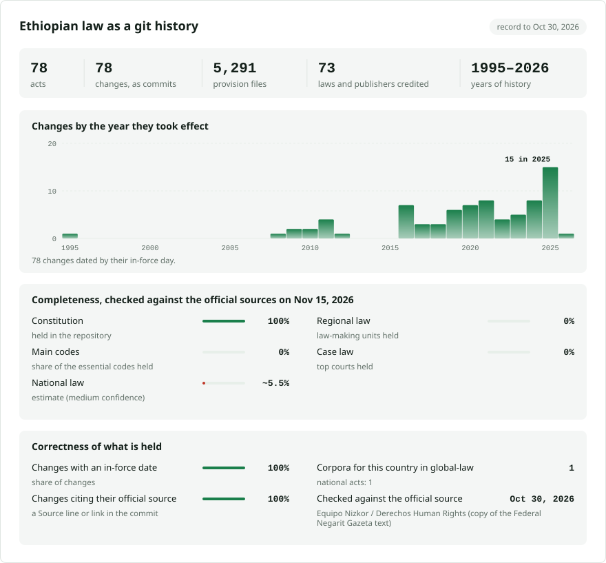

# Ethiopia: law history in git

<picture>
<source media="(prefers-color-scheme: dark)" srcset="data/effort-dark.svg">

</picture>

The law of Ethiopia as a git history: one file per article, one commit per version on the day it took effect, and the law that made each change as the commit's author. `git blame` names the law behind every paragraph; `git log` lists every change to an article; picking a date gives the text in force that day.

Part of [lexifina/global-law](https://github.com/lexifina/global-law), one git history for every country's law: this is Ethiopia's national law, which global-law reads at `ethiopia/national/acts/`.

**What is in it now:** the Constitution of 1995, 518 federal proclamations and 135 Council of Ministers regulations, each as first published in the Federal Negarit Gazette (18,235 files); one more proclamation, in force from 21 July 2027, is on the `future` branch. See [STRUCTURE.md](STRUCTURE.md) for the layout.

Each act has its own folder, by type, year and number, one file per article: `proclamations/2019/1156-labour/art-077.md` is Article 77 of the Labour Proclamation No. 1156/2019, the amount of annual leave; the Constitution is in `constitution/`.

The text is in English, the English column of the bilingual Federal Negarit Gazette. The Amharic text, which prevails where the two differ, is not part of this record.

## Questions as git commands

| Question | Command |
| --- | --- |
| Every change to Article 77 of the Labour Proclamation | `git log -p --word-diff -- proclamations/2019/1156-labour/art-077.md` |
| Which law wrote each line of Article 77? | `git blame proclamations/2019/1156-labour/art-077.md` |
| Every version of the Labour Proclamation, with the day each took effect | `git log --format="%h %(trailers:key=In-force,valueonly,separator=) %an" -- proclamations/2019/1156-labour ':!*/README.md'` |
| Article 77 as in force on 1 January 2026 | `python3 tools/law.py show 2026-01-01 ethiopia/national/acts/proclamations/2019/1156-labour/art-077.md` (in global-law) |

**Outside git**, we also host this record publicly, for free:

- **[Ask Claude about Ethiopian law](https://global-law.lexifina.com/v1/try_claude?country=ethiopia)**: opens Claude with a first question ready.
- **[Ask ChatGPT](https://global-law.lexifina.com/v1/try_chatgpt?country=ethiopia)**: the same question in ChatGPT.
- **[Search Ethiopian law on our site](https://lexifina.com/law?country=ethiopia&q=annual+leave)**: a search for "annual leave", with each provision's text and its versions, no account needed.
- **[Developer REST API](https://global-law.lexifina.com/v1/search_law?query=annual+leave&jurisdiction=ethiopia)**: the same search as JSON, with no key. See the [documentation here](https://lexifina.com/api/global-law).

Both assistants read the record through the free Global law connector (MCP, `https://global-law.lexifina.com/mcp`); the first time, the chat gives you the link that adds it. Ask in English.

**Host it yourself easily.** All it takes is git and Python, and the tools run on your machine:

```sh
git clone --depth 1 https://github.com/lexifina/global-law && cd global-law
python3 tools/countries.py add ethiopia/national/acts
python3 tools/law.py show 2026-01-01 ethiopia/national/acts/proclamations/2019/1156-labour/art-077.md
```

Opened in Claude Code, Cursor, VS Code or Codex, the clone also starts a local MCP server with the same tools ([MCP.md](https://github.com/lexifina/global-law/blob/main/MCP.md)).

## Dates

Each commit is dated at noon, Africa/Addis_Ababa, on the day the version took effect, and carries it in its `In-force:` trailer:

- the Constitution, 21 August 1995, the day Proclamation No. 1/1995 says it came into full force (it was ratified on 8 December 1994);
- a proclamation, the day its own effective-date article gives: for most, publication in the Federal Negarit Gazette, so the issue's date;
- a few name another day: an earlier one (the day the House of Peoples' Representatives adopted the Federal Courts, Excise Tax, Electoral and House of Federation proclamations; 8 July 2016 for the Income Tax Proclamation), or a later one (Social Health Insurance, a year after publication; Critical Infrastructure Cybersecurity, 21 July 2027, on the `future` branch until then, which `tools/on.py` reads for later days).

Each version is credited to the proclamation that made it (the Constitution to Proclamation No. 1/1995). Six acts are labelled "oldest version available" and credited to the publisher, `Federal Negarit Gazette (House of Peoples' Representatives); issue PDFs as hosted by MetaAppz`. The committer is Lexifina.

## How it is checked

- `tools/check_repo.py` reads every version back from git on the day it took effect and on the day before, compares it file by file with the corpus it was built from, and checks every commit's trailers; [`REPRODUCE.md`](REPRODUCE.md) does not yet record a run for the published build.
- A second build from the same corpus into an empty folder gave identical hashes for all 78 history commits and 152 tags (see `REPRODUCE.md`).
- Misprints in the Gazette (an article heading printed with the wrong number, a line missing from the English text) are listed one by one in `REPRODUCE.md`; the wording is kept as printed.
- History is append-only: new acts go on top (`tools/append.py`), and no published commit is rewritten.
- [vulnerabilities/](vulnerabilities/README.md): possible drafting mistakes in Ethiopian law, found by global-law's detectors and checked by hand.

## What it does not show

- **Clean text of the four core codes.** The Civil Code (1960), Criminal Code (2004), Civil Procedure Code (1965) and Criminal Procedure Code (1961) in `codes/` are the OCR text layers of third-party scans (`Text-source: publisher OCR (third-party scan; known reading errors)`); misread words are kept, and articles whose heading was not read as one sit inside the article before them.
- **Amendments.** Each act is held once, as first published; later amending proclamations are not applied, so an article may differ from the text in force today.
- **Every federal act.** Only issues whose PDF has an English text layer and whose articles, signature and in-force day pass the checks are here; scanned issues (no OCR is used) and issues that fail a check are left out and listed in `REPRODUCE.md`. Directives, regional law, case law and bills are not here.
- **The Amharic text, and PART, CHAPTER and SECTION headings.** Each file starts with its article's number and heading.
- **Articles that start later than the rest of their act** (Federal Courts Proclamation, Article 56(2): Articles 11 to 15, six months on) are dated with the rest.
- **The Constitution from the Gazette itself.** Its text is a third-party copy of Federal Negarit Gazeta no. 1 of 1995.

## Sources

| Source | Kind | Past versions | Notes |
| --- | --- | --- | --- |
| [MetaAppz](https://www.metaappz.com/) | Federal Negarit Gazette issues (bilingual PDFs), hosted by a third party | no, each act as first published | The English column of each issue's own text layer (the Commercial Code from its separate English book); MetaAppz is credited as the source of the bytes, not the publisher |
| [Ministry of Justice law register](https://justice.gov.et/en/laws/) | Federal Negarit Gazette PDFs, official | no, each act as first published | Used for acts whose MetaAppz copy failed a check or was missing; commits carry `Source-status: official copy (...)` |
| [LawEthiopia](https://www.lawethiopia.com/), [Citizenship Rights in Africa](https://citizenshiprightsafrica.org/) | Scans of the four core codes | one text each | OCR text layer of the scan, tagged `Text-source: publisher OCR (third-party scan; known reading errors)` |
| [Equipo Nizkor / Derechos Human Rights](https://www.derechos.org/intlaw/doc/eth2.html) | Third-party copy of the Constitution (Proclamation No. 1/1995, Federal Negarit Gazeta no. 1) | one text; it has not been amended | Credited as the source of the bytes, not the publisher |

## Licence

See [`LICENSE`](LICENSE). Official legal texts are not protected by copyright in Ethiopia: the Copyright and Neighbouring Rights Protection Proclamation No. 410/2004, Article 5(b), excludes "any official text of a legislative, administrative or of legal nature, as well as official translations thereof". Lexifina's own contributions (the arrangement of the history, the commit messages, the tables and the tools) are CC0 1.0.

No AI model wrote, translated or corrected legal text, and none runs when the history is built; the scripts were written by an AI model (see [`REPRODUCE.md`](REPRODUCE.md)).

## Visualisations

- [visualisations/](visualisations/): charts drawn from this repository. Not drawn yet.

## More

From [lexifina/global-law](https://github.com/lexifina/global-law):

- [FEATURES.md](https://github.com/lexifina/global-law/blob/main/FEATURES.md): every feature, and what every corpus must support (`git blame`, `law.py`, the MCP tools)
- [FAQ.md](https://github.com/lexifina/global-law/blob/main/FAQ.md): questions and answers · [CONTRIBUTING.md](https://github.com/lexifina/global-law/blob/main/CONTRIBUTING.md): proposing changes · [MCP.md](https://github.com/lexifina/global-law/blob/main/MCP.md): the MCP server · [REPRODUCE.md](https://github.com/lexifina/global-law/blob/main/REPRODUCE.md): how it was built · [CHANGELOG.md](https://github.com/lexifina/global-law/blob/main/CHANGELOG.md)
- [FRESHNESS.md](https://github.com/lexifina/global-law/blob/main/FRESHNESS.md): how current each corpus is · [Monitoring](https://github.com/lexifina/global-law/tree/main/monitoring): whether updates are running · [WATCHING.md](https://github.com/lexifina/global-law/blob/main/WATCHING.md): how each official source is watched for changes
- [performance/](https://github.com/lexifina/global-law/tree/main/performance): how fast the tools are, measured
- [visualisations/](https://github.com/lexifina/global-law/tree/main/visualisations): charts and bridges across the world's law
- [Vulnerabilities](https://github.com/lexifina/global-law/tree/main/vulnerabilities): mistakes in legislation as published
