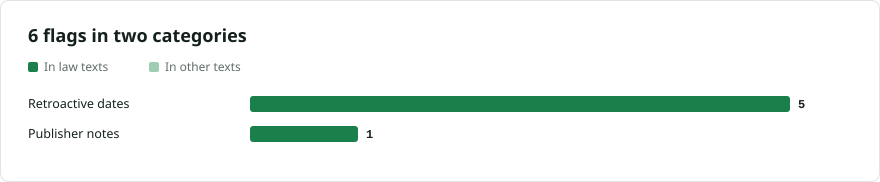

# Vulnerabilities in Ethiopian law

<picture>
<source media="(prefers-color-scheme: dark)" srcset="img/flags-by-category-dark.svg">

</picture>

The vulnerability detectors from [lexifina/global-law](https://github.com/lexifina/global-law/tree/main/vulnerabilities) look for mechanical mistakes in legislation: a rule applying "until" a date that has passed, a law dated in force before it was published, a provision repealed before its replacement took effect, two amendments to the same provision on the same day, an amount changed in one place but not in another, a reference to an article that no longer exists. global-law's published list (9 November 2026) had no flags for Ethiopia. This is a run over this repository only, as it stood at commit [`c93d347`](https://github.com/lexifina/ethiopia-law/commit/c93d34727e247f6f98c4af068d7fca9cd2c9b0c4) on 16 November 2026: the Constitution of 1995 and 77 federal proclamations, each in its English text as first published.

**In short:** the detectors raised 6 flags, and none is a mistake in Ethiopian law. Five are proclamations dated in force before the Federal Negarit Gazette published them, and in each the date is the proclamation's own: four take effect, by their effective-date article, on the day the House of Peoples' Representatives adopted them (the Federal Courts, Electoral Code, Excise Tax and House of Federation proclamations), and the Federal Income Tax Proclamation applies to income derived from 8 July 2016, six weeks before its issue. The model reviewed the five; it was shown two of each act's files, such as its signature, not its effective-date article, and kept one, the House of Federation proclamation, as a possible defect, which the article itself answers. The sixth flag is a duty to keep an "explanatory note" in the Federal Public Procurement and Property Administration Proclamation, read as a publisher's note. Before a fix to one detector, 3 more flags were raised, all misreadings of English: two repeal articles that repeal an earlier proclamation, and a rule that information in a register "shall be deleted by line" when corrected, read as articles marked repealed or deleted. This repository holds each act once, as first published, and applies no amending proclamation, so no article's text ever changes in its history, and the detectors that compare versions (repeal gaps, same-day conflicts, empty periods, stale amounts, references to deleted provisions) had nothing to compare. No text in the law it holds runs "until" a date: each "until" is followed by an event ("until replaced by regulations"), so the search for lapsed time limits found nothing either. The detectors found no mistake in Ethiopian law. Reading the flagged proclamations and their neighbours turned up a problem in how this repository reads article headings, listed below. Later, this will be formalised in Lean, similar to our work on [the US tax code](https://lexifina.com/blog/formalizing-the-us-tax-code) and [US case law](https://lexifina.com/blog/formalizing-all-us-case-law-in-lean).

A flag is a prompt to look, not legal advice, and nothing here has been tested in court.

## Flags by category

| Category | What it looks for | Flags | In law texts | Reviewed | Survived review |
| --- | --- | ---: | ---: | ---: | ---: |
| Retroactive or pre-publication dates | A law dated in force before it was published | 5 | 5 | 5 | 1 |
| Publisher notes | A publisher's note that an amendment could not be carried out | 1 | 1 | 0 | 0 |

"In law texts" counts all the law this repository holds: the Constitution and every proclamation, article by article, with their preambles and signatures, and the seven articles of the proclamation that enacts the Commercial Code. The other files are this repository's READMEs and root files (the licence, `REPRODUCE.md`, `jurisdiction.json`), `data/` and `tools/`; none has a flag. The history has 78 changes to the law, one per act: the Constitution and 71 proclamations as enacted, and six proclamations in the oldest version available, credited to the Gazette. No act's text changes after its first version and no article is ever deleted, so there are no repeal gaps, same-day conflicts, empty periods, stale amounts or references to deleted provisions. The amounts are in birr, the currency in use, or in US dollars, so there are no dead currencies. Dates in the Ethiopian calendar do not reach the detectors, which read Gregorian month names only, but nothing is lost: the law texts name an Ethiopian month in six places, each a month or day that recurs every year (the fiscal year "from 1st Hamle to 30th Sene", a request "before Meskerem 30"), and none has "E.C." with a year; the two such dates in this repository are Gazette issue dates in `REPRODUCE.md`.

*Edge cases: the six flags, checked by hand, and what the 3 flags before the fix were, in [EDGE-CASES.md](EDGE-CASES.md).*

## Problems found in this repository

- **Article headings cut at the PDF's line break:** where the Gazette prints a heading on two lines, the second line becomes the article's first line of text. A scan of the headings found 16. In the Legal Metrology Proclamation No. 1344/2024 alone there are five ([`art-014.md`](https://github.com/lexifina/ethiopia-law/blob/c93d34727e247f6f98c4af068d7fca9cd2c9b0c4/legal-metrology/art-014.md): "# Article 14: Powers and Duties of Legal Metrology Officers" over "and Repairers"), in the Foreign Nationals' Ownership Right of Residential House Proclamation No. 1388/2025 three (Articles 4, 8 and 14), and one each in the Civil Aviation (Article 25), Federal Government-Owned Enterprises ([Article 8](https://github.com/lexifina/ethiopia-law/blob/c93d34727e247f6f98c4af068d7fca9cd2c9b0c4/government-owned-enterprises/art-008.md), "the State-" over "owned Enterprise"), Payment for Ecosystem Services (Article 7), Public Enterprises Privatization (Article 4), Special Economic Zone (Article 9) and Technical and Vocational Education and Training (Article 4) proclamations. In Article 59 of the House of Federation proclamation the rest of the heading runs into the first sentence ([`art-059.md`](https://github.com/lexifina/ethiopia-law/blob/c93d34727e247f6f98c4af068d7fca9cd2c9b0c4/a-proclamation-to-define-the-powers-and-function/art-059.md): "Peoples Representatives The House of Peoples' Representatives shall enact civil law…"), and in Article 30 of the Health Service Administration and Regulation Proclamation No. 1362/2024 the second line reads "Reproductive Reproductive Reproductive Reproductive Cell Cell Cell Cell or Embryo" ([`art-030.md`](https://github.com/lexifina/ethiopia-law/blob/c93d34727e247f6f98c4af068d7fca9cd2c9b0c4/health-service/art-030.md)), each word four times. The other way round, the heading of Article 30 of the Animal Health and Welfare Proclamation No. 1376/2025 takes in the start of its text ([`art-030.md`](https://github.com/lexifina/ethiopia-law/blob/c93d34727e247f6f98c4af068d7fca9cd2c9b0c4/animal-health-and-welfare/art-030.md): "# Article 30: 3o. The Powers and Duties of the Ministry The Ministry shall:"). The words are the source's; the cuts are not the proclamations'.

## Files

| File | What it holds |
| --- | --- |
| [data/flags.csv](data/flags.csv) | Every flag, one row per provision and issue |
| [data/reviewed.csv](data/reviewed.csv) | The flags the model reviewed, with its verdict and reason |
| [data/by_category.csv](data/by_category.csv) | The counts in the table above |
| [tools/](tools/) | The scripts that made this run |

Columns: `category`, `detector`, `kind` (`law` or `other`), `path` (the file in this repository; for a retroactive date, the act's first article), `date` (the date the flag turns on, where there is one), `reference` (the act or line involved), `summary`, `score` (the detector's ranking, 0 to 1), `review` (`artefact`, `lawful` or `candidate_defect`), `survives_rebuttal`, `review_note` (the model's reason), `url` (the file, or for a retroactive date the act's commit, at the commit that was read).

## How it was made

- **Detectors:** global-law's [vulnerabilities/scripts](https://github.com/lexifina/global-law/tree/main/vulnerabilities/scripts), with the fixes in [tools/patch_detectors.py](tools/patch_detectors.py) and, for English text, [tools/patch_en.py](tools/patch_en.py) and [tools/patch_en_et.py](tools/patch_en_et.py), run on this repository at commit `c93d347`. The history table the detectors read was built from this repository's own commits (the law that made each change, and the `In-force` and `Kind` trailers): 78 commits count as law; the 15 that change only documentation, tables and tools are left out. The corpus language was set to English, so the detectors read English month names and dates.
- **Model review:** gpt-5.4-mini, the 40 strongest flags per category it reviews, one pass saying whether a flag is real and a second arguing that it is not. Here that was the five retroactive dates; there were no lapsed time limits or empty periods. The model does not review publisher notes.
- **Hand check:** every flag was read in this repository's text, with the effective-date article and the signature of each proclamation dated before its issue, the Gazette issue dates in `REPRODUCE.md`, and the 3 flags raised before the fix. The heading problems were found by a scan of every article file's first two lines and were not checked against the Gazette's PDFs.

To report a correction, open an issue with the provision and an official source.

## Licence

The lists and notes are Lexifina's, dedicated to the public domain under CC0 1.0, like this repository's arrangement, commit messages, tables and tools. Quoted law text is the English text of the Constitution and of the proclamations as the Federal Negarit Gazette publishes them; Article 5(b) of the Copyright and Neighbouring Rights Protection Proclamation No. 410/2004 excludes from protection "any official text of a legislative, administrative or of legal nature, as well as official translations thereof". See [LICENSE](../LICENSE).
